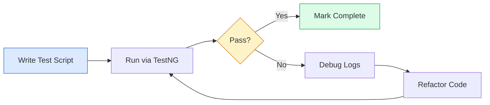

# Veeva System Testing Demo 🚀

<p align="center">
  
</p>

<p align="center">
  
  
  
  
</p>

## 📌 About This Branch
This **orphan branch** is a dedicated demo environment created to perform, validate, and debug automated test cases without affecting the main codebase.

**Purpose:**
* ✅ **Isolate Test Execution:** Run experimental tests safely.
* ✅ **Practice Frameworks:** Hands-on implementation of Selenium & TestNG.
* ✅ **Debug & Fix:** Analyze failures and improve script reliability.

---

## 🛠️ Test Scenarios Covered

| ID | Test Scenario | Status | Tools Used |
|---|---|---|---|
| **TS_01** | Login Functionality Validation | ✅ **Pass** | Selenium, TestNG |
| **TS_02** | User Registration Form | 🔄 **In Progress** | Selenium, Faker |
| **TS_03** | Search & Filter Results | ⏳ **Pending** | Selenium, Waits |
| **TS_04** | API Response Validation | ⏳ **Pending** | REST Assured |

---

## 📂 Project Structure

```bash
VeevaTesting/
├── src/
│   ├── main/java/       # Utility classes & Base pages
│   └── test/java/       # Test scripts & TestNG suites
├── pom.xml              # Maven dependencies
└── testng.xml           # Test suite configuration
```

## 🎯 Testing Workflow



---

<p align="center">
  <strong>Built for Learning • Executed for Quality</strong>
</p>
