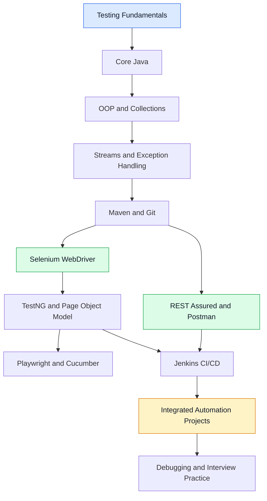
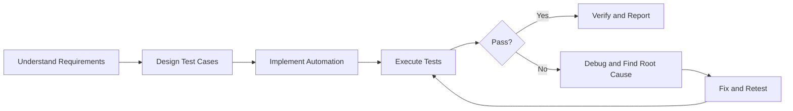

# Java Automation Engineering 🚀

  

  
  
  
  
  
  
  

## 📌 Overview

A hands-on Java Automation Engineering repository focused on learning, practising, and implementing software testing concepts and automation tools aligned with the **Veeva Associate Automation Engineer curriculum**.

## 🛠️ Tech Stack

| Category | Technologies |
|---|---|
| Programming | Java, OOP, Collections, Streams, Lambdas |
| UI Automation | Selenium WebDriver, Playwright |
| Test Frameworks | TestNG, Cucumber, Gherkin |
| API Testing | Postman, REST Assured, REST APIs |
| Build Tools | Maven |
| Version Control | Git, GitHub |
| CI/CD | Jenkins |
| Database | SQL, RDBMS |
| Cloud | AWS |
| Operating Systems | Linux |
| AI-Assisted Automation | Gemini, Claude, MCP, Playwright MCP |
| Testing Fundamentals | SDLC, QA, SIT, UAT, Agile, Waterfall |

## 🗺️ Learning Roadmap

## 📚 Topics Covered

- [ ] **Testing Fundamentals:** SDLC, QA, SIT, UAT, Agile, Waterfall, JIRA, XRay, Confluence
- [ ] **Core Java:** Syntax, variables, control flow, arrays, methods, OOP, Collections, Streams, Lambdas, exceptions and Java I/O
- [ ] **Design Patterns:** Singleton, Builder and configuration management
- [ ] **Maven:** Dependencies, lifecycle, plugins, profiles, multi-module projects and Nexus
- [ ] **Git & GitHub:** Cloning, commits, branches, fetch, pull, merge, rebase and conflict resolution
- [ ] **Selenium:** WebDriver, locators, waits, browser interactions, dropdowns, frames, windows, screenshots and POM
- [ ] **TestNG:** Annotations, assertions, groups, DataProviders, listeners and parameterization
- [ ] **Playwright:** Setup, configuration, UI interactions, synchronization and test execution
- [ ] **API Testing:** REST, HTTP methods, status codes, Postman, REST Assured, authentication, JSON/XML and schema validation
- [ ] **BDD:** Gherkin, Cucumber, feature files, scenarios, step definitions, tags and hooks
- [ ] **Jenkins:** Jobs, pipelines, triggers, SCM polling, webhooks and failure analysis
- [ ] **AWS:** EC2, S3, EBS, AMI, Lambda, ECS, EKS, ECR and AWS CLI
- [ ] **SQL & RDBMS:** DDL, DML, DCL, TCL, joins, constraints and normalization
- [ ] **Linux:** Commands, permissions, file operations, logs, resource monitoring and shell scripting
- [ ] **AI Tools:** Gemini, Claude, CLI workflows, Markdown, agents, skills and MCP

## 🧪 Practical Work

- Java programming exercises and OOP implementations
- Reusable Selenium automation framework using TestNG, Maven and POM
- API automation suites using REST Assured
- Data-driven testing and configuration management
- Playwright UI automation tests
- Cucumber BDD scenarios
- Git-based project workflows
- Jenkins test execution pipelines
- SQL queries and Linux command-line exercises
- AI-assisted automation experiments

## 🎯 Testing Approach

Focus areas include positive and negative testing, boundary conditions, meaningful assertions, reliable synchronization, reusable code, debugging, and root-cause analysis.

## 📈 Progress

| Area | Status |
|---|---|
| Testing Fundamentals | 🔄 In Progress |
| Core Java | 🔄 In Progress |
| Selenium & TestNG | ⏳ Learning |
| API Testing | ⏳ Learning |
| Maven & Git | ⏳ Learning |
| Playwright & Cucumber | ⏳ Learning |
| Jenkins, AWS, SQL & Linux | ⏳ Learning |

*Progress is updated as practical exercises and implementations are completed.*

## 📖 References

- [Java Documentation](https://docs.oracle.com/en/java/)
- [Selenium Documentation](https://www.selenium.dev/documentation/)
- [TestNG Documentation](https://testng.org/)
- [Apache Maven](https://maven.apache.org/guides/)
- [Git Documentation](https://git-scm.com/doc)
- [Playwright Documentation](https://playwright.dev/docs/intro)
- [REST Assured](https://github.com/rest-assured/rest-assured/wiki/Usage)
- [Cucumber Documentation](https://cucumber.io/docs/)
- [Jenkins Documentation](https://www.jenkins.io/doc/)
- [AWS Documentation](https://docs.aws.amazon.com/)
- [Postman Documentation](https://learning.postman.com/docs/)
- [MySQL Documentation](https://dev.mysql.com/doc/)

---

  <strong>Learn • Practise • Automate • Debug • Improve</strong>

  

