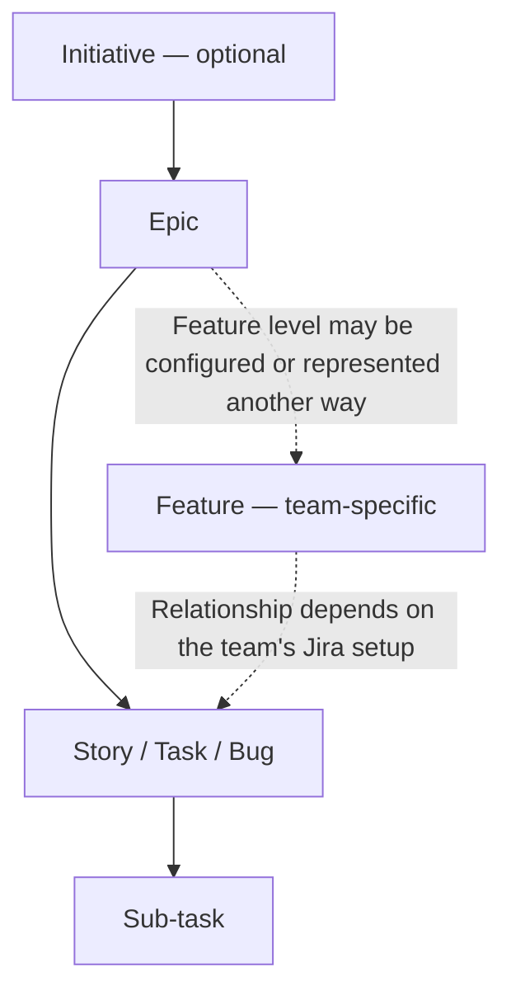
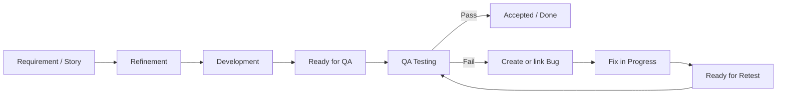
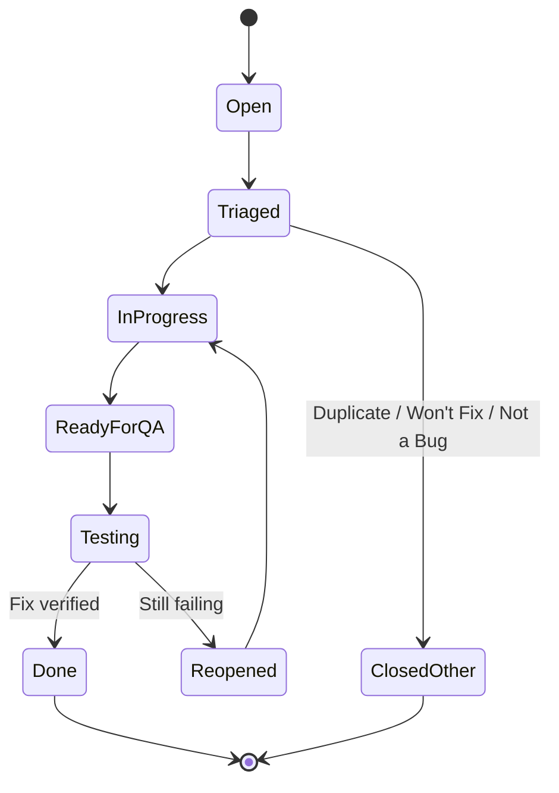
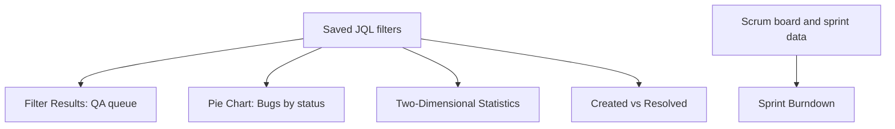

<div align="center">

# Jira QA Learning Journey


[](https://www.atlassian.com/software/jira)
[](#learning-roadmap)
[](https://mermaid.js.org/)
[](#jira-for-a-qa-engineer)

**A practical, example-driven journey from Jira basics to confident day-to-day QA usage.**

[Learning Roadmap](#learning-roadmap) · [QA Workflows](#jira-for-a-qa-engineer) · [JQL Practice](#jql-practice) · [Progress Tracker](#progress-tracker)

</div>

---

## Repository description

> A hands-on Jira learning roadmap for QA engineers: spaces, work items, epics, stories, bugs, workflows, Scrum/Kanban, defect lifecycle, JQL, filters, dashboards, practical exercises, and a planned Jira Xray module.

## Why this repository exists

This repository is my structured learning notebook for understanding Jira well enough to use it in a real QA team—not merely memorize terminology. It combines concepts, examples, diagrams, templates, exercises, and revision notes.

The primary syllabus is the **“Jira Epics, Features and User Stories — Practical Guide”** PDF provided for this learning journey. Its core areas are work hierarchy; epics, features and stories; acceptance criteria; story points and priority; breaking stories into sub-tasks; Definition of Done; JQL; dashboards; and a quick-start checklist. Examples in that guide are illustrative, so company-specific practices must be confirmed with the actual team.

> **Terminology note:** This workspace uses the Jira Cloud terms **Space** and **Work item**. Many teams, training materials, JQL fields, and older Jira screens still say **Project** and **Issue**. Learn to recognize both. Your company's configuration and process take precedence over generic examples.

## What I want to be able to do

By working through this repository, I aim to be able to:

- Navigate Jira and find the correct space, board, work item, filter, and dashboard.
- Read, create, update, comment on, assign, and link work items responsibly.
- Understand the difference between an Initiative, Epic, Feature, Story, Task, Bug, and Sub-task—and know which hierarchy levels are configurable.
- Read requirements, identify functional and non-functional expectations, and turn acceptance criteria into positive, negative, boundary, and edge-case tests.
- Report defects with clear reproduction steps, expected and actual results, environment, evidence, and useful links.
- Understand statuses, workflow transitions, backlog, sprints, Scrum, Kanban, estimates, releases, and team conventions.
- Find work with basic search and write useful JQL queries.
- Use saved filters and dashboards to answer practical QA questions.
- Recognize when a field, workflow, work type, permission, or process is company-specific rather than universal Jira behavior.
- Learn Jira Xray later as a separate test-management module after core Jira is clear.

## Table of contents

- [Learning roadmap](#learning-roadmap)
- [How work is organized in Jira](#how-work-is-organized-in-jira)
- [End-to-end work flow](#end-to-end-work-flow)
- [Work item screen: field guide](#work-item-screen-field-guide)
- [Jira for a QA engineer](#jira-for-a-qa-engineer)
- [User stories and acceptance criteria](#user-stories-and-acceptance-criteria)
- [Bug report template](#bug-report-template)
- [Agile boards: Scrum and Kanban](#agile-boards-scrum-and-kanban)
- [JQL practice](#jql-practice)
- [Dashboards and reports](#dashboards-and-reports)
- [Hands-on labs](#hands-on-labs)
- [Progress tracker](#progress-tracker)
- [Suggested repository structure](#suggested-repository-structure)
- [Learning rules and QA mindset](#learning-rules-and-qa-mindset)
- [Reference links](#reference-links)

---

## Learning roadmap

The roadmap is staged so that each concept builds on the previous one. Xray is deliberately placed at the end.

| Phase | Topics | Practical outcome |
|---|---|---|
| **00 — Foundations** | What Jira is, spaces, work items, work types, keys, navigation, search, permissions at a user level | Find the right place and the right work item without guessing |
| **01 — Work item screen** | Summary/title, description, status, assignee, reporter, priority, labels, components, parent, versions, comments, history, attachments, links | Understand a work item's context before editing or testing it |
| **02 — Work hierarchy** | Initiative (optional), Epic, Feature (configuration-dependent), Story, Task, Bug, Sub-task | Understand how large outcomes are broken into trackable work |
| **03 — Requirements** | Business goals, functional and non-functional requirements, user stories, INVEST, Given/When/Then, acceptance criteria, Definition of Ready, Definition of Done | Check whether a story is clear and testable before execution |
| **04 — Agile delivery** | Workflow, statuses, transitions, backlog, Scrum, Kanban, sprint planning, estimation, story points, blockers, ranking | Understand how work moves through a team |
| **05 — QA and defects** | Test design, bug creation, reproduction steps, expected vs. actual, severity vs. priority, evidence, linking bugs, retesting, regression, reopening | Report and track defects professionally |
| **06 — Search and JQL** | Quick/basic search, advanced search, JQL fields, operators, functions, sorting, saved filters | Find the exact set of work needed for a QA task |
| **07 — Dashboards and reports** | Gadgets, filter results, pie charts, two-dimensional statistics, sprint burndown, created-vs-resolved | Monitor testing and defect status with useful views |
| **08 — Team configuration and productivity** | Spaces, work types, fields, screens, components, releases, permissions, notifications, automation, integrations | Recognize what your team uses and what only an administrator can configure |
| **09 — Scenario practice** | Requirement ambiguity, blocked stories, incomplete fixes, test evidence, reporting and interview scenarios | Explain decisions with a clear QA rationale |
| **10 — Later: Jira Xray** | Test artifacts, test organization, execution, coverage, and defect relationships in the Xray app | Learn how the team's test-management approach fits with Jira |

### Core syllabus coverage from the provided guide

The learning path preserves these key sections from the source guide:

1. Jira work hierarchy and options for representing Features.
2. Writing Epics, Features, user stories, and acceptance criteria.
3. Suggested story fields such as summary, description, story points, priority, parent, labels/components, and fix version.
4. Example product domains: e-commerce, mobile banking, online learning, and healthcare.
5. Breaking stories into sub-tasks and using a Definition of Done.
6. Dashboard setup, JQL filters, and typical gadgets.
7. A practical quick-start sequence from project/space setup through sprint review.

The source guide uses illustrative example keys such as `SHOP-1` and `BANK-1`; these are not real company requirements. Actual field labels, issue/work types, hierarchy, and reporting features can vary.

---

## How work is organized in Jira

A useful mental model is: **business outcome → deliverable capability → trackable work → smaller execution steps**. The exact hierarchy depends on Jira configuration.



### What each work type is for

| Name | Simple meaning | Example | QA perspective |
|---|---|---|---|
| **Initiative** | Broad strategic outcome spanning multiple epics | Improve the digital customer experience | Understand the larger objective behind the work |
| **Epic** | Large body of work delivering a business outcome | Customer authentication | See how related stories contribute to a goal |
| **Feature** | A user-visible capability, if the team models this level | Password recovery | Confirm where the team's setup places Features |
| **Story** | A user need with a benefit | Log in using email and password | Test behavior against acceptance criteria |
| **Task** | Work that needs to be completed | Update API logging | Verify the requested task's completion criteria |
| **Bug** | A defect where observed behavior differs from expected behavior | Login succeeds with an incorrect password | Record evidence and track the fix and retest |
| **Sub-task** | A smaller step beneath a supported parent work item | Automate invalid-login tests | Track a defined part of the larger work item |

**Important hierarchy distinction:** The standard Jira hierarchy is generally **Epic → Story/Task/Bug → Sub-task**. A Feature is not automatically a default level between Epic and Story. Some teams add hierarchy configuration, use an app, or use a field/label/component to group work. Confirm the arrangement in your company's Jira.

---

## End-to-end work flow

This is a learning model—not a claim that every company's workflow has the same statuses.



### Example scenario

A story says: **“A registered user can log in with valid credentials.”** During testing, the application also allows login with an incorrect password.

1. Verify the actual behavior against the requirement and acceptance criteria.
2. Record reliable reproduction steps, expected behavior, actual behavior, environment, and evidence.
3. Create a separate Bug work item in the correct space, if that is your team's process.
4. Link the bug to the related story using the relationship supported by the team's configuration.
5. Move the work only through permitted workflow transitions.
6. Retest after the fix, check relevant regression risks, and record the result.

The story and the bug are separate work items. A bug is not automatically a sub-task of the story.

---

## Work item screen: field guide

Field visibility and editability depend on work type, screen layout, permissions, and configuration.

| Field or area | What it tells you | QA usage |
|---|---|---|
| **Key** (e.g. `LOGIN-101`) | Unique identifier | Share the exact item in comments and team discussions |
| **Summary / Title** | Short description of the work | Quickly understand the item's purpose |
| **Description** | Requirement, problem, context, or instructions | Understand what needs to be tested or delivered |
| **Acceptance criteria** | Conditions that must be satisfied | Derive clear test scenarios and pass/fail decisions |
| **Status** | Current stage of work | Check whether the item is ready for testing or blocked |
| **Workflow transition** | An allowed movement between states | Progress work according to the team's process |
| **Assignee** | Person currently responsible for the work | Know who is expected to progress the item |
| **Reporter** | Person who reported or created it | Know where a question or clarification originated |
| **Priority** | Relative urgency | Help the team make triage decisions |
| **Severity** (if configured) | Impact of a defect | Describe how seriously the behavior affects users or the system |
| **Labels** | Flexible tags | Search for groups such as `api`, `smoke`, or `regression` |
| **Components** (if used) | Product/module grouping | Identify a responsible technical or product area |
| **Parent / linked work** | Relationship to other work items | Trace requirements, tasks, and defects |
| **Fix version / release** (if used) | Planned release association | Confirm which release a fix is intended for |
| **Comments** | Team discussion and updates | Record concise investigation or retest notes |
| **Attachments** | Supporting files | Add appropriate screenshots, logs, or documents |
| **Activity / history** | Events and field changes Jira exposes | Investigate what changed and when |
| **Work log** (if used) | Recorded effort/time | Follow the team's time-tracking policy |

### Before you start testing a work item

- [ ] Check its key, type, summary, space, and current status.
- [ ] Read the description and every available acceptance criterion.
- [ ] Identify unclear, missing, contradictory, or untestable requirements.
- [ ] Check the assignee, priority, parent, links, attachments, and relevant release/build details.
- [ ] Confirm the test environment and build through your team's process.
- [ ] Ask for clarification when expected behavior is ambiguous; do not invent product rules.

---

## Jira for a QA engineer

Jira helps a QA engineer communicate testing status and connect findings to the work they affect. It does **not** replace good test design, evidence, or investigation.

### QA activities and what to record

| Activity | What to do | What good looks like |
|---|---|---|
| Requirement review | Check the story and acceptance criteria | Ambiguities and missing expected behavior are raised early |
| Test design | Consider positive, negative, boundary, and edge cases | Coverage reflects user risks, not only the happy path |
| Test execution | Follow the approved environment/build and test data rules | Results are reproducible and tied to the correct work |
| Bug reporting | Document concise reproduction steps and expected/actual results | Another person can reproduce the issue without guessing |
| Triage | Provide impact, frequency, evidence, and relevant context | The team can evaluate severity and priority rationally |
| Retesting | Verify the specific fix and relevant nearby behavior | Pass/fail evidence is recorded; failed fixes are not marked as passed |
| Regression | Recheck likely affected areas | Changes are evaluated for unintended side effects |
| Status communication | Use comments and transitions according to team process | Work status reflects reality and is not advanced prematurely |

### Defect lifecycle example



> The states above are illustrative. Some Jira workflows use different names, combine states, require a resolution field, or restrict transitions to particular roles.

### Severity versus priority

- **Severity** describes the impact of the defect on functionality, users, data, security, or operations.
- **Priority** describes how urgently the team should address it relative to other work.

They are related but not identical. A company may define severity and priority through custom fields and triage rules. Follow the company's definitions rather than assuming a universal scale.

---

## User stories and acceptance criteria

### User story template

> **As a** `[type of user]`, **I want** `[goal]`, **so that** `[benefit]`.

Example:

> As a registered user, I want to log in using my email and password so that I can access my account securely.

### The INVEST checklist

The provided syllabus uses INVEST as a quick quality check for stories:

| Letter | Meaning | Question to ask |
|---|---|---|
| **I** | Independent | Can the story be worked on without unnecessary dependencies? |
| **N** | Negotiable | Is there room for discussion before implementation? |
| **V** | Valuable | Is there a clear user or business benefit? |
| **E** | Estimable | Does the team have enough clarity to estimate it? |
| **S** | Small | Can the team complete it within its planning window? |
| **T** | Testable | Can QA identify observable pass/fail conditions? |

The guide suggests commonly used point values such as 1, 2, 3, 5, and 8, and recommends splitting work estimated above 8 points. These are learning examples, not a rule for every company; teams define their own estimation conventions.

### Given / When / Then

```gherkin
Given I am on the login page
And I have a registered account
When I enter a valid email and password
And I submit the login form
Then I should be authenticated
And I should see the expected signed-in state
```

A useful set of acceptance criteria should cover the happy path, relevant negative cases, and important limits or boundaries. Avoid vague statements such as “works correctly.” Do not invent missing business rules; ask the product owner, analyst, or appropriate owner to clarify them.

### Requirement and test-design coverage

For each meaningful requirement, ask:

- **Functional:** What must the system do?
- **Non-functional:** What quality or constraint must be met—for example, performance, accessibility, security, reliability, or usability—when the requirement specifies it?
- **Positive:** Does expected input produce the expected behavior?
- **Negative:** Does invalid or unauthorized input get handled safely?
- **Boundary:** What happens at the minimum, maximum, or exact threshold?
- **Edge case:** What happens in unusual but plausible conditions, such as a network interruption or repeated submission?

Not every ticket needs every category. Select tests based on the actual requirement, risk, and available acceptance criteria.

---

## Bug report template

Use this template when practising. Adapt it to your team's required fields and defect workflow.

```markdown
## Summary
[Short, specific description of the defect]

## Environment
- Application / URL:
- Environment: Dev / QA / Staging / Production (as applicable)
- Build / Version:
- Browser / OS / Device:
- Test data (non-sensitive reference only):

## Preconditions
- [Required setup or account state]

## Steps to reproduce
1. [First action]
2. [Second action]
3. [Action that exposes the defect]

## Expected result
[What the requirement or acceptance criteria says should happen]

## Actual result
[What actually happened]

## Reproducibility
[Always / Intermittent / Once, with useful frequency details]

## Evidence
[Screenshot, short recording, console/network log, or other approved evidence]

## Impact / Severity rationale
[Who or what is affected, scope, and impact]

## Related work
[Story key, parent, linked work, or release if applicable]
```

**Good defect-writing habits:** use a precise summary, number the steps, separate expected from actual behavior, state the environment, and include relevant evidence. Never put passwords, authentication tokens, secret keys, or unnecessary personal/customer data in Jira comments or attachments.

---

## Agile boards: Scrum and Kanban

| Concept | Scrum | Kanban |
|---|---|---|
| Work cadence | Timeboxed sprints | Continuous flow |
| Planning | Select work for a sprint | Replenish and prioritize the flow of work |
| Main views | Backlog, active sprint board, sprint reports (when configured) | Board organized around workflow stages |
| Useful measures | Sprint progress, burndown, velocity where used | Work in progress, throughput, cycle time where tracked |
| QA question | What can the team finish and verify in this sprint? | Where is testing work accumulating or getting blocked? |

Your team's real process may be Scrum, Kanban, or a variation. Do not assume that every space has a sprint or backlog.

### Workflow vocabulary

- **Status:** the current state of a work item.
- **Transition:** an allowed movement from one state to another.
- **Workflow:** the statuses and transitions defining how the work progresses.
- **Backlog:** prioritized work not yet selected or started, when the team's setup provides one.
- **Sprint:** a fixed period for planned work in Scrum.
- **Blocker:** a dependency or problem preventing progress; teams may represent it with a flag, field, label, or status.
- **Definition of Ready (DoR):** a team-agreed checklist for when an item is sufficiently understood to start.
- **Definition of Done (DoD):** a team-agreed checklist for what completion means.

### Example Definition of Done

Adapted from the provided guide's example:

- Code reviewed and merged according to team policy.
- Acceptance criteria verified by QA.
- Required automated tests pass in the agreed pipeline.
- No unresolved high-priority defects that violate the team's release criteria.
- Documentation is updated where needed and the product owner accepts the story when required.

The actual DoD is agreed by the team. A work item being moved to “Done” does not by itself prove that every required quality check occurred.

---

## JQL practice

**JQL** means Jira Query Language. It helps search for precise sets of work items and can power saved filters and dashboard gadgets. Terminology is still evolving in Jira Cloud, and some queries may continue to use legacy names such as `project` and `issuetype`. Use the field names and autocomplete available in your own Jira instance.

> Replace `LOGIN` with your actual space/project key. The examples assume a software-style setup and may need adjustment for your team's fields and permissions.

### 1. My unfinished work

```jql
project = LOGIN
AND assignee = currentUser()
AND statusCategory != Done
ORDER BY priority DESC
```

**Question answered:** What unfinished work is assigned to me?

### 2. Unresolved bugs by priority

```jql
project = LOGIN
AND issuetype = Bug
AND resolution = Unresolved
ORDER BY priority DESC
```

**Question answered:** Which unresolved bugs should the team review first?

### 3. Stories in an active sprint

```jql
project = LOGIN
AND issuetype = Story
AND sprint in openSprints()
```

**Question answered:** Which stories are associated with an open sprint? This depends on Scrum and sprint configuration.

### 4. Items marked as blocked

```jql
project = LOGIN
AND labels = blocked
AND statusCategory != Done
```

**Question answered:** Which unfinished work uses the `blocked` label? The label convention must be agreed by the team.

### 5. Stories without estimates

```jql
project = LOGIN
AND issuetype = Story
AND "Story Points" is EMPTY
AND statusCategory != Done
```

**Question answered:** Which unfinished stories do not have an estimate in a field called `Story Points`? Some instances use another field name, such as `Story point estimate`, or a custom field.

### 6. Work completed during the last seven days

```jql
project = LOGIN
AND statusCategory = Done
AND resolved >= -7d
```

**Question answered:** Which work items show as resolved during the last seven days? Confirm how your workflow maintains resolution and how your team defines completion.

### JQL learning sequence

1. Start with one condition, such as a space/project key.
2. Add a work type or status.
3. Narrow by assignee, label, priority, sprint, or date.
4. Combine conditions using `AND` and `OR` with deliberate grouping.
5. Sort results with `ORDER BY`.
6. Validate the result set before saving or sharing a filter.
7. Reuse saved filters in dashboards where appropriate.

---

## Dashboards and reports

A dashboard combines gadgets that show useful slices of work. It should answer a concrete question, not merely display charts for decoration.

| Gadget / report | Possible QA use |
|---|---|
| **Filter Results** | Show a practical list of unresolved high-priority bugs or items awaiting retest |
| **Pie Chart** | View work items split by status, priority, or another available field |
| **Two-Dimensional Filter Statistics** | Compare statuses against priorities, assignees, or other fields |
| **Created vs. Resolved Chart** | See whether bugs are being created faster than resolved over a period |
| **Sprint Burndown** | Understand remaining work during a sprint where Scrum reports are enabled |
| **Open / blocked / unestimated work filter** | Identify issues needing triage, an estimate, or a dependency update |

Gadget names, report availability, and layout can vary by Jira plan, configuration, and permissions. An epic burndown report may be a board report rather than a built-in dashboard gadget; check your own instance before expecting a specific gadget.

### Example dashboard design



A useful dashboard should help answer questions such as:

- What needs QA attention today?
- Which defects are high priority and unresolved?
- What is blocked or waiting for retest?
- Are more bugs being opened than resolved?
- Is sprint work progressing as expected?

---

## Hands-on labs

Complete exercises in a practice space or sandbox where you have permission. Do not create, edit, transition, or delete company work simply to experiment.

### Lab 1 — Navigation and search

- [ ] Locate a space using the navigation or search.
- [ ] Open a known work item by its key.
- [ ] Identify the work type, summary, status, assignee, reporter, and parent/links if shown.
- [ ] Explain which fields you can edit and which appear restricted.

**Success check:** You can find the correct item and explain its context without changing it.

### Lab 2 — Work item anatomy

- [ ] Read the description and acceptance criteria.
- [ ] Locate comments, history/activity, attachments, and linked work items.
- [ ] Identify missing information that would prevent confident testing.
- [ ] Write one concise clarification question.

**Success check:** You can separate known requirements from assumptions.

### Lab 3 — Write a user story

- [ ] Choose a simple feature such as password reset.
- [ ] Write the As a / I want / So that statement.
- [ ] Add Given/When/Then acceptance criteria for happy path, error handling, and a meaningful boundary.
- [ ] Evaluate the story using INVEST.

**Success check:** Another tester can design tests from the criteria without inventing expected behavior.

### Lab 4 — Write a defect

- [ ] Use the bug template to report a fictional login defect.
- [ ] Separate expected behavior from observed behavior.
- [ ] Include environment, reproducibility, and evidence references.
- [ ] Explain the impact and propose a severity rationale without confusing severity with priority.

**Success check:** A developer could reproduce the problem using only the report.

### Lab 5 — JQL and saved filters

- [ ] Run a query for your own unfinished work.
- [ ] Search for unresolved bugs.
- [ ] Add and remove one condition to understand how the result set changes.
- [ ] Save a useful filter if you have permission.

**Success check:** You can explain every clause and confirm that the results match the question.

### Lab 6 — Dashboard reasoning

- [ ] Select one QA question that a dashboard should answer.
- [ ] Identify the filter/data source needed.
- [ ] Choose an appropriate gadget or report.
- [ ] Explain what decision the dashboard helps the team make.

**Success check:** The view supports a real action, not just a visual display.

---

## Progress tracker

Mark a topic complete only after you can explain it in simple terms, give a realistic example, use it correctly, and answer a scenario-based question. Reading about a feature alone is not evidence of mastery.

- [ ] Jira purpose and Space / Project, Work item / Issue terminology
- [ ] Navigation, recent items, starred items, search, and space views
- [ ] Work item keys, types, summaries, descriptions, and field layout
- [ ] Status, transitions, workflow, assignee, reporter, priority, and resolution
- [ ] Comments, attachments, activity/history, work logs, and linked items
- [ ] Initiative, Epic, Feature options, Story, Task, Bug, and Sub-task
- [ ] User stories, INVEST, functional and non-functional requirements
- [ ] Acceptance criteria with Given / When / Then
- [ ] Definition of Ready and Definition of Done
- [ ] Story points, priority, dependencies, and backlog refinement
- [ ] Scrum, Kanban, sprint planning, and board basics
- [ ] Test design: positive, negative, boundary, and edge cases
- [ ] Bug reporting, severity vs. priority, triage, retest, and regression
- [ ] Basic search, advanced search, JQL, operators, functions, and sorting
- [ ] Saved filters and practical dashboard gadgets
- [ ] Components, versions/releases, fields, permissions, and notifications
- [ ] Company-specific workflow recognition and responsible Jira updates
- [ ] Scenario-based practice and evaluation revision
- [ ] Later: Jira Xray concepts and test-management workflow

**Readiness standard:** I will treat a topic as interview-ready only after I can explain it, use it in a practical scenario, identify common mistakes, and justify my QA decision. The checklist records learning progress; it is not a claim of certification.

---

## Suggested repository structure

As the learning notes grow, I can organize the repository like this:

```text
jira-qa-learning-journey/
├── README.md
├── GITHUB_REPO_DESCRIPTION.txt
├── docs/
│   ├── syllabus-notes.md
│   ├── jira-navigation.md
│   ├── work-item-fields.md
│   ├── hierarchy-and-user-stories.md
│   ├── workflows-and-agile.md
│   ├── qa-defect-lifecycle.md
│   ├── jql-cheatsheet.md
│   ├── dashboards-and-reports.md
│   └── xray/                 # Add during the later Xray phase
├── templates/
│   ├── user-story-template.md
│   ├── bug-report-template.md
│   └── acceptance-criteria-template.md
├── exercises/
│   ├── navigation-lab.md
│   ├── story-writing-lab.md
│   ├── bug-reporting-lab.md
│   └── jql-lab.md
└── diagrams/
    └── jira-workflows.md
```

This is a suggested structure, not a requirement of Jira. Add the provided syllabus PDF under `docs/` only if you are allowed to store a copy in this repository.

---

## Learning rules and QA mindset

1. **Understand before updating.** Read the requirement, status, links, and context before changing a work item.
2. **Do not invent requirements.** Ask the responsible person to clarify ambiguous expected behavior.
3. **Use evidence.** Distinguish observed facts from assumptions and include appropriate reproduction details.
4. **Make status truthful.** Do not mark a fix as verified before executing the required retest.
5. **Respect the workflow.** Use the transitions and fields enabled by your team; ask when access or process is unclear.
6. **Avoid sensitive data.** Never store passwords, tokens, production secrets, or unnecessary personal data in learning notes or defect attachments.
7. **Learn the reason, not only the click path.** Be able to explain why a field, query, relationship, or report is useful.
8. **Separate standard Jira from customization.** Your company may rename fields, change statuses, add work types, or install apps.
9. **Practice safely.** Use a sandbox for experiments and follow team conventions in shared company spaces.
10. **Revise actively.** Explain concepts aloud, solve one scenario at a time, and revisit topics that you cannot yet apply independently.

---

## Later module: Jira Xray

Xray is intentionally **out of scope for the first Jira lessons**. After core Jira is understood, this repository can expand into the test-management concepts your company actually uses in Xray, such as:

- Xray's test-related work types and how they differ from ordinary Jira work items.
- Organizing test cases and reusable prerequisites/preconditions where applicable.
- Test plans and test executions.
- Recording execution results and evidence.
- Connecting test coverage to requirements/stories and associating defects with failed tests.
- Understanding reports, permissions, and the team's chosen Xray workflow.

The exact names, available features, and setup depend on the installed Xray version and company configuration. This section is a future learning outline, not a claim about your company's Xray setup.

---

## Reference links

### Primary learning syllabus

- **Jira Epics, Features and User Stories — Practical Guide** (provided PDF): the primary syllabus for hierarchy, requirements, story writing, examples, sub-tasks, Definition of Done, JQL, dashboards, and quick-start guidance. Keep a permitted copy in `docs/` if appropriate.

### Official Jira and GitHub documentation

- [Atlassian — What is a work item?](https://support.atlassian.com/jira-software-cloud/docs/what-is-a-work-item/)
- [Atlassian — Work in Jira Cloud spaces](https://support.atlassian.com/jira-software-cloud/docs/work-in-jira-cloud-spaces/)
- [Atlassian — Create a work item and a subtask](https://support.atlassian.com/jira-software-cloud/docs/create-a-work-item-and-a-subtask)
- [Atlassian — Search and find your work items](https://support.atlassian.com/jira-software-cloud/docs/search-and-find-your-issues/)
- [Atlassian — Use advanced search with Jira Query Language (JQL)](https://support.atlassian.com/jira-software-cloud/docs/use-advanced-search-with-jira-query-language-jql/)
- [Atlassian — JQL fields](https://support.atlassian.com/jira-software-cloud/docs/jql-fields/)
- [Atlassian — Create and edit dashboards](https://support.atlassian.com/jira-software-cloud/docs/create-and-edit-dashboards/)
- [GitHub Docs — About README files](https://docs.github.com/en/repositories/managing-your-repositorys-settings-and-features/customizing-your-repository/about-readmes)
- [GitHub Docs — Creating diagrams with Mermaid](https://docs.github.com/en/get-started/writing-on-github/working-with-advanced-formatting/creating-diagrams)
- [Readme Typing SVG — Animated header](https://github.com/DenverCoder1/readme-typing-svg)

---

<div align="center">

**Learn the concept → see a realistic example → practise it → explain your decision like a QA engineer.**

Progress over memorization. Evidence over assumptions. Quality over status updates.

</div>
